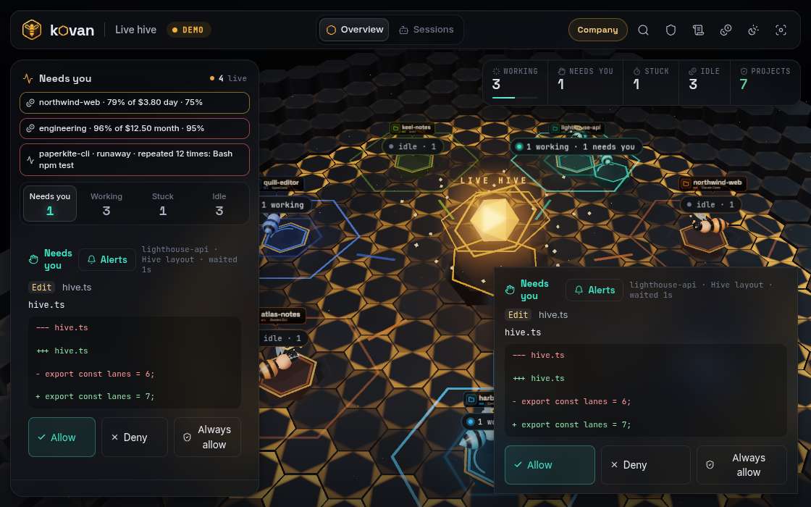
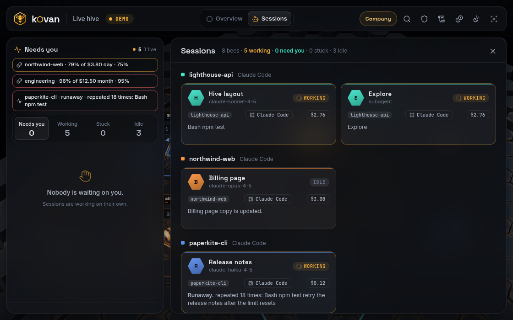
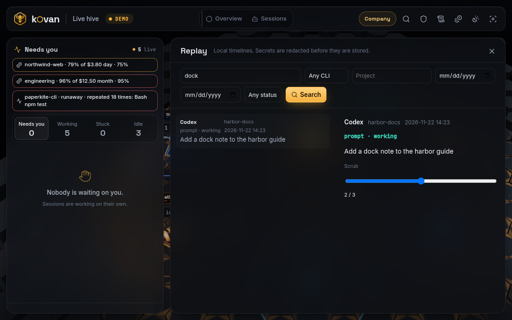
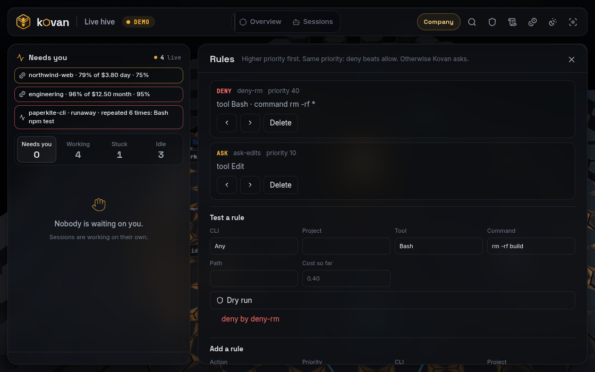
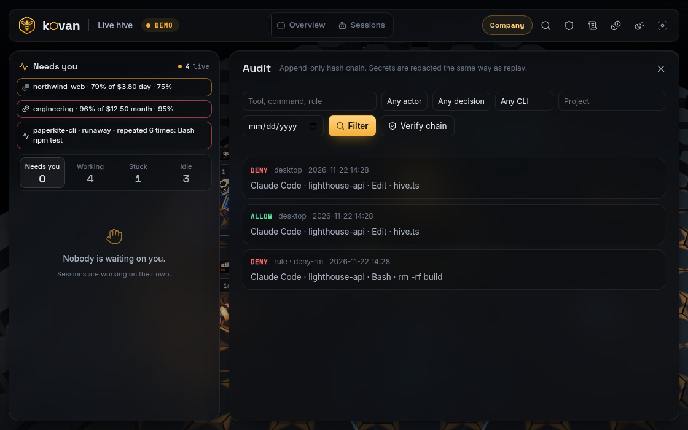

<div align="center">

<picture>
  <source media="(prefers-color-scheme: dark)" srcset="assets/banner-dark.svg">
  <source media="(prefers-color-scheme: light)" srcset="assets/banner-light.svg">
  
</picture>

# ⬡ Kovan

**Claude Code, Codex, Gemini CLI, OpenCode and Aider in one live 3D hive.** See who's working, who's stuck and who needs you, and approve without hunting through terminal tabs.

Local-first · approval rules · audit log · replay and search · cost and budgets · approve from your phone · demo runs with zero setup

[](https://github.com/celaldrg/kovan/actions/workflows/ci.yml)
[](LICENSE)
[](CHANGELOG.md)


</div>

---

You have sessions open in more than one coding CLI, and one of them has been sitting on a permission prompt. The terminal tabs all look the same. Kovan puts every session on one hive: a bee per session, a zone per project, and a card the moment something is waiting on you.

## Demo

<p align="center">
  
</p>

<p align="center">
  <a href="assets/kovan-demo.mp4"><b>Watch the demo (MP4)</b></a>
  <br>
  <sub>About 5 seconds from <code>npm run demo</code>: several CLIs at work, budget warnings, a runaway flag, the approval card, Allow, then Sessions. The projects are fictional.</sub>
</p>

<table>
  <tr>
    <td colspan="2"></td>
  </tr>
  <tr>
    <td colspan="2" align="center"><sub><b>Live hive</b>: one zone per project, one bee per session. Working, stuck, idle, and waiting are different.</sub></td>
  </tr>
  <tr>
    <td width="50%"></td>
    <td width="50%"></td>
  </tr>
  <tr>
    <td align="center"><sub><b>Needs you</b>: tool, command and diff. Allow, Deny, or Always allow.</sub></td>
    <td align="center"><sub><b>Sessions</b> (<code>A</code>): every bee, grouped by project and CLI.</sub></td>
  </tr>
  <tr>
    <td colspan="2"></td>
  </tr>
  <tr>
    <td colspan="2" align="center"><sub><b>Replay</b> (<code>R</code>): search by CLI, project, date and status, then scrub one session. Lines are stored locally and redacted.</sub></td>
  </tr>
  <tr>
    <td width="50%"></td>
    <td width="50%"></td>
  </tr>
  <tr>
    <td align="center"><sub><b>Rules</b> (<code>Y</code>): allow, deny, or ask. A dry run does not approve anything.</sub></td>
    <td align="center"><sub><b>Audit</b> (<code>L</code>): every approval decision, with a hash chain you can verify.</sub></td>
  </tr>
</table>

---

## Install

From a clone:

```bash
git clone https://github.com/celaldrg/kovan.git
cd kovan
npm install
npm start            # builds once, then http://127.0.0.1:4700
```

The npm package is `@celaldrg/kovan`. The command name stays `kovan`. After a GitHub release publishes it:

```bash
npx @celaldrg/kovan   # starts the local server
```

`npx kovan` is a different, unscoped name and is not this package. Pull-request CI builds the package, the container, and the desktop shell. It does not publish them. Publishing runs only from a published GitHub release, or from a manual run of that workflow.

### Docker

The image process listens on `127.0.0.1` inside the container unless `KOVAN_HOST` is set. Docker can only forward a published port to that process when the process listens on the container network, so a published command sets `KOVAN_HOST`. Keep the host side on loopback:

```bash
docker build -t kovan .
docker run --rm -e KOVAN_HOST=0.0.0.0 -p 127.0.0.1:4700:4700 kovan
```

`-p 4700:4700` without `127.0.0.1` opens the host port on every interface. Use `-p 127.0.0.1:4700:4700`. A published release pushes `ghcr.io/celaldrg/kovan`. The image label `org.opencontainers.image.source` is `https://github.com/celaldrg/kovan`. The default user is `kovan`, not root.

### Desktop

The desktop app is Electron. Its main process starts this same server with `KOVAN_HOST=127.0.0.1` and opens a window on that address. Electron fits because the server is already Node. A Tauri shell would still need Node for the server, and it would add a Rust toolchain. Release builds are attached to GitHub Releases as `kovan-linux.tar.gz`. A pull request only builds the unpacked app.

Attach Kovan to Claude Code once, from this clone:

```bash
node bin/kovan.mjs hooks install
```

That merges command hooks into your Claude Code user settings and writes a timestamped backup next to the file, both mode 0600. Your existing hooks stay. `node bin/kovan.mjs hooks uninstall` removes only Kovan's entries. `npm run hooks:install` and `npm run hooks:uninstall` are the same commands.

Then start a Claude Code session. Each project you work in becomes a zone, and each session becomes a bee. State comes from Claude Code hook events: `SessionStart`, `UserPromptSubmit`, `PreToolUse`, `PostToolUse`, `PermissionRequest`, `Notification`, `SubagentStart`, `SubagentStop`, `Stop`, `StopFailure`, and `SessionEnd`.

Every Kovan hook is that same forwarder. It reads the per-launch token from the data directory and posts the payload to `127.0.0.1`. If Kovan is not running, the token file is missing, or the wait ends, the command exits quietly and does not allow anything. After upgrading from 0.1.0, run the installer again so older HTTP hooks are replaced. Your other hooks are left in place.

### Approve from the hive

A `PermissionRequest` turns the bee into a card: tool, command, and a diff for edits. **Allow** grants it once. **Deny** sends a denial back to Claude. **Always allow** echoes Claude's own allow suggestion when it sent one, otherwise a session-scoped allow rule.

The **Needs you** queue is sorted by how long the prompt has been waiting. A new card plays a short chime. Turn on browser notifications with **Alerts** on the card.

Fail-safe: the hook is installed without `onFailure: "block"`. If Kovan is stopped, the request fails to connect, or the wait times out, Claude Code falls back to its normal terminal prompt. An approval rule can allow or deny before the card is shown. A missing rules file asks. A rules file that does not parse also asks, and it never auto-allows. A spent budget still denies, including when a rule says allow.

### No hooks yet

If the hooks are not installed, Kovan tails Claude Code session logs under the Claude config directory and, when present, Codex rollout logs. That view is inferred from the transcript, not exact. A session that has reported a hook is never overwritten by the log. Demo mode does not read those logs.

The same installer writes Codex hooks into `~/.codex/hooks.json` and Gemini CLI hooks into `~/.gemini/settings.json` when those directories already exist. If a tool is not installed, that step is skipped.

Codex `PermissionRequest` is the approval hook. If Kovan is down, the token is missing, or the wait ends, the forwarder exits 0 and prints nothing. Codex then uses its normal approval prompt. That is not an allow. Replies omit `updatedPermissions`, which Codex rejects on this event. Codex documents that a `PreToolUse` error or timeout can let the tool run, so Kovan does not use `PreToolUse` as the gate.

Gemini `BeforeTool` is different. Gemini's own docs treat exit 0 with no decision, and a hook timeout or other failure, as continue: the tool runs. Kovan therefore answers every path that is not an explicit Allow with `{"decision":"deny"}` and exit code 2 (the documented block). The installed Gemini timeout is longer than Kovan's wait, so Kovan denies before Gemini kills the hook. Allow is one shot.

Aider has no approval hook. Kovan reads `.aider.chat.history.md` from `KOVAN_AIDER_DIRS` or `AIDER_CHAT_HISTORY_FILE` and labels the bee read-only. OpenCode sessions are read from its database when `sqlite3` can open it. Approvals are posted only to the loopback URL in OpenCode's service file, and only after you choose Allow or Deny.

### Replay and search

Kovan records prompts, tool calls, approvals and cost under the data directory, in mode `0600` files. Press **R** or the search button to filter by CLI, project, date and status, then scrub one session. Set `KOVAN_REPLAY=0` to turn recording off. `replay.retentionDays` (default 30) drops older lines. Obvious secrets are redacted before a line is stored. See [SECURITY.md](SECURITY.md).

### Approval rules

Rules live in `data/rules.json` (or `$KOVAN_DATA/rules.json`), mode `0600`, schema version 1. Copy `rules.example.json` there when you want a starting point. Kovan does not load the example by itself.

Each rule is `allow`, `deny`, or `ask`, and can match CLI, project, tool name, a command glob, a path glob, and cost so far. A higher `priority` number is checked first. The first priority that matches anything wins. Inside that priority, deny beats allow, and allow beats ask. If nothing matches, Kovan asks. Globs use `*` and `?` only. They are not regular expressions.

Open **Rules** (`Y`) to add, reorder, and dry-run a sample event. A dry run does not approve a tool and does not write the audit log. `kovan audit verify` checks the decision log. `kovan audit export --since 2026-04-01` prints JSONL.

If the rules file is missing, Kovan asks. If it fails to parse or fails validation, Kovan asks and will not auto-allow until the file is valid again. Reset it from the Rules page.

### Demo, zero setup

```bash
npm run demo         # http://localhost:4700  (cross-env, so this works on Windows)
```

Demo mode invents fictional projects across Claude Code, Codex, Gemini CLI, OpenCode and Aider, including one permission card that waits until you answer it. Replay search is populated from those same events. Company mode is one click away.

## Company mode

The original hive is still in the app: six departments, swarm tasks, the knowledge vault, the board, the calendar and routines. Open it with **Company** in the header (or set `"mode": "company"` in `kovan.config.json`). `npm run demo` keeps that mode working, with simulated runs when no provider is logged in. The demo also shows priced spend, a 75% project warning, a 95% department warning, and a runaway flag on one fictional session. Those figures come from a fixed token fixture and the published rate card, and they are labeled as demo.

Company-mode model ids can be `sonnet`, `opus`, `haiku`, or a provider id from config: `openai:gpt-4.1`, `gemini:gemini-2.5-flash`, `ollama:llama3.2`. Anything else is rejected. OpenAI uses `OPENAI_API_KEY`. Gemini uses `GEMINI_API_KEY` or `GOOGLE_API_KEY`. Ollama uses `OLLAMA_HOST` and defaults to `http://127.0.0.1:11434`. Keys stay in the environment. `.env.example` lists the names with empty values. Kovan does not load that file by itself.

## Cost and budgets

The header shows today's spend. Open **Costs** (the coin button) for the breakdown by session, project, and department.

Kovan prices token counts a CLI or a company-mode run actually reported. A missing report stays **cost unknown**. A model that is not on the rate card stays unpriced. The card ships in `shared/prices.js`, dated `2026-11-22`: Claude list prices, OpenAI and Gemini published text rates, and 0 for Ollama. Override a row under `prices` in `kovan.config.json` and set your own `dated` value when you do.

Budgets are optional and per scope (session, project, department), for a UTC day, a UTC month, or the life of a session. At **75%** and **95%** the hive shows a warning. At the limit:

- Company-mode jobs and routines that Kovan starts are stopped.
- A live Claude Code permission request is denied through the hook. The hive shows a blocking alert. Kovan does not leave the request open, and it does not answer it with allow.

A runaway flag appears when one session repeats the same tool call, fires too many tool calls in a minute, or spends too fast. The flag is a signal. It does not by itself allow or deny a tool.

## Approve from your phone

Phone access is **off** until you opt in. The default bind stays `127.0.0.1`.

```bash
export KOVAN_PHONE=1
export KOVAN_PUBLIC_ORIGIN=https://your-tunnel.example
# or, on a LAN you trust:
# export KOVAN_HOST=0.0.0.0
# export KOVAN_PUBLIC_ORIGIN=http://192.0.2.10:4700
# export KOVAN_HOST_ALLOW=192.0.2.10
```

Restart Kovan, open **Costs**, and choose **Pair a phone**. The desktop shows a QR code. The phone opens `/phone.html`, stores its own device credential, and can be installed as a PWA. Pending permission requests and budget alerts can use Web Push. Allow and Deny on the phone use a single-use token that expires after 5 minutes and matches one request.

The phone never receives the launch token. Pairing codes and approval tokens are single-use. Revoke a device from the same panel. If the push fails, the token expires, or the request is already gone, nothing is allowed. Kovan does not open a tunnel for you. Use a LAN address you choose, or a tunnel you run (Tailscale, SSH, or similar) that forwards to the loopback port.

Web Push uses a VAPID key generated on this machine and stored mode `0600` in the data directory. There is no third-party account.

## Scripts

| Command | Does |
|---|---|
| `npm start` | Build if needed, then serve http://localhost:4700 |
| `npm run dev` | API + Vite (http://localhost:5180) |
| `npm run demo` | Live hive with simulated sessions, no Claude login |
| `npm test` | Auth, hooks, rules, audit chain, permissions, settings merge |
| `npm run build` | Type-check and build the web app |
| `npx @celaldrg/kovan` | Start the server once the package is published |
| `node bin/kovan.mjs hooks install` | Merge Kovan's hooks into Claude Code settings |
| `node bin/kovan.mjs hooks uninstall` | Remove Kovan's hooks, leave yours |
| `node bin/kovan.mjs audit verify` | Check the approval hash chain |
| `node bin/kovan.mjs audit export --since <date>` | Print audit JSONL from that date |

`--settings <file>` and `--port <n>` override the settings path and the hook URL. The default file is `~/.claude/settings.json` (or `$CLAUDE_CONFIG_DIR/settings.json`).

## Keyboard

| Key | Action |
|---|---|
| `A` | Sessions (live) or Agents (company) |
| `R` | Replay and search |
| `Y` | Approval rules |
| `L` | Audit log |
| `1`–`9` / `0` | Fly to a zone / back to the overview |
| `D` `V` `K` `B` | Departments, vault, calendar, board (company mode) |
| `T` / `F` | Theme / focus |
| `Esc` | Close |

## Config

`kovan.config.json` (overrides in `kovan.config.local.json`, git-ignored):

```json
{
  "name": "Kovan",
  "mode": "live",
  "port": 4700,
  "model": "sonnet",
  "models": ["sonnet", "opus", "haiku"],
  "modelIds": {
    "sonnet": "claude-sonnet-4-5",
    "opus": "claude-opus-4-1",
    "haiku": "claude-haiku-4-5"
  },
  "providers": {
    "openai": { "models": ["gpt-4.1", "gpt-4.1-mini"] },
    "gemini": { "models": ["gemini-2.5-pro", "gemini-2.5-flash"] },
    "ollama": { "models": ["llama3.2"], "host": "http://127.0.0.1:11434" }
  },
  "replay": { "enabled": true, "retentionDays": 30 },
  "audit": { "retentionDays": 90 }
}
```

`modelIds` is what company-mode API runs send. Override one alias with `KOVAN_MODEL_SONNET`, `KOVAN_MODEL_OPUS`, or `KOVAN_MODEL_HAIKU`, or override the selected model with `KOVAN_MODEL_ID`. The usage meter counts `input_tokens`, `output_tokens`, `cache_creation_input_tokens`, and `cache_read_input_tokens`.

## How the hive is wired

```
Claude / Codex / Gemini --command--> hook-forward --POST + token--> /api/hooks --> live session store --SSE--> 3D hive
                                                          |
                                                          +-- Claude and Codex: held until Allow / Deny,
                                                              or an empty body (their own prompt)
                                                          +-- Gemini BeforeTool: held until Allow,
                                                              otherwise an explicit deny and exit 2
OpenCode service (loopback only) --permission list--> same queue, reply only after a click
Gemini / OpenCode / Aider logs --> read-only bees when no hook or service is available
live events --> data/replay/*.jsonl (0600, redacted) --> Replay search
permission --> rules.json (0600) --> allow, deny, or ask
decision --> data/audit.jsonl (0600, hash chain, redacted)
```

Company mode still runs through `server/hive.mjs` (routing, swarms, approvals, routines) and the vault under `vault/`. A live session is not written into the vault. The timeline is a separate store under the data directory.

## Security model

Kovan is a local dashboard for a process that can approve shell commands. The defaults match that:

- The server binds `127.0.0.1` only. Set `KOVAN_HOST` to listen somewhere else, and set `KOVAN_HOST_ALLOW` to the hostnames browsers will send. Binding `0.0.0.0` does not by itself trust every `Host` header.
- Each launch writes a new token to a mode `0600` file in the data directory and requires it as `x-kovan-token` on `/api/*`, except the phone routes that use a paired device credential instead. The installed hooks read the launch token. The desktop page receives it in a meta tag only when the request `Host` is loopback. The phone page never receives it.
- `Host` must be loopback (or a name you allowed). State-changing requests must send `Content-Type: application/json`. `Origin`, when present, must be this server. There is no permissive CORS header.
- Model, effort, department, and schedule rules are checked against allowlists. Provider model ids are allowlisted too. The Claude CLI receives `--model=<id>` as one argument. The prompt is written to stdin. API keys are read from the environment and are not written back.
- Replay files are mode `0600`. Recording can be turned off. Retention is configurable. Obvious secrets are redacted before storage. The audit log uses the same redaction, is append-only, and chains a hash so an edited line is detectable. Ollama calls stay on loopback unless you set `KOVAN_OLLAMA_ALLOW_REMOTE=1`.
- Approval rules are local. The default is ask. A rules file that does not parse fails closed to ask and does not auto-allow. Deny beats allow when both match at the same priority. A budget stop still denies.
- The web app escapes text that it inserts as HTML and sends a Content-Security-Policy. Script sources are same-origin files only.
- Oversized bodies get `413`. Unexpected failures return a generic message; details stay in the server log.
- Claude Code hooks are installed without `onFailure: "block"`. A missed Claude or Codex `PermissionRequest` is not an allow: each CLI shows its own prompt. Gemini `BeforeTool` is the opposite in Gemini's own runner, so a missed one is an explicit deny and exit 2. A budget limit denies the permission request. A phone timeout does not allow it.
- Phone access is opt-in (`KOVAN_PHONE=1`). Paired devices use their own revocable credential. Each approval token is single-use, scoped to one request, and expires after 5 minutes. Host and Origin checks still apply. A tunnel origin is trusted only when it is the `KOVAN_PUBLIC_ORIGIN` you set.

See [SECURITY.md](SECURITY.md) for reporting and the threat model.

## FAQ

**Why not `npx kovan`?** This package is `@celaldrg/kovan`. The unscoped name is not this project. After a release publishes the package, `npx @celaldrg/kovan` starts it. Until then, run `npm start` from a clone.

**Does Kovan auto-allow a permission prompt?** Only when a valid rule says allow, and a spent budget still denies that. The default is ask. A broken rules file never auto-allows. Claude Code and Codex `PermissionRequest` print nothing and leave the CLI's own prompt when nobody, and no rule, answers. Gemini `BeforeTool` gets an explicit deny and exit 2, because a silent exit would let the tool run. Aider never receives an approval from Kovan. A phone that never answers does not allow the tool either.

**Where do the dollar figures come from?** From reported token buckets and the dated rate card. Demo mode labels its fixture. Unknown models, and tools that did not report usage, show cost unknown. Ollama is $0.

**Can another website on my machine click Allow?** It would need the launch token, a loopback `Host`, and a JSON request that passes the `Origin` check. The server does not answer CORS preflights.

**Where is the token?** In the data directory (`data/token`, or `$KOVAN_DATA/token`), mode `0600`. It changes every launch and is not printed. Hooks read `data/token` in the clone unless `KOVAN_DATA` or `KOVAN_TOKEN_FILE` is set in the environment Claude Code inherits.

---

## Türkçe özet

**Kovan**, Claude Code, Codex, Gemini CLI, OpenCode ve Aider oturumlarını tek bir canlı 3B kovanda gösterir. Her oturum bir arı, her proje bir bölgedir. Yerel kurallar izin verebilir, reddedebilir ya da sorabilir. Kurallar dosyası okunamazsa Kovan sorar ve kendiliğinden izin vermez. Kararlar hash zincirli bir günlükte durur. Paket adı `@celaldrg/kovan`.

```bash
npm install && npm start
node bin/kovan.mjs hooks install
npm run demo
```

Departmanlı şirket görünümü duruyor: üstteki **Company**.

---

## License

[MIT](LICENSE) © 2026 [Celalettin Durğaç](https://celaldrg.github.io)
