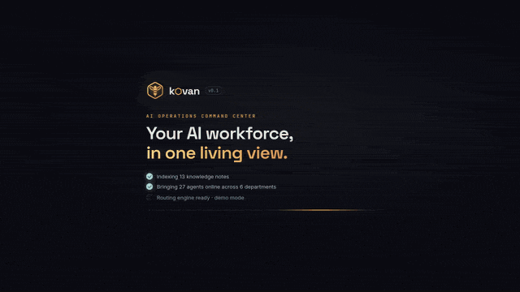
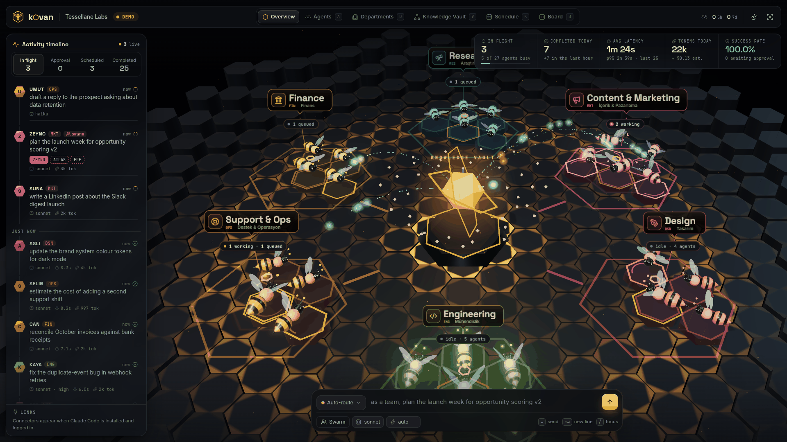
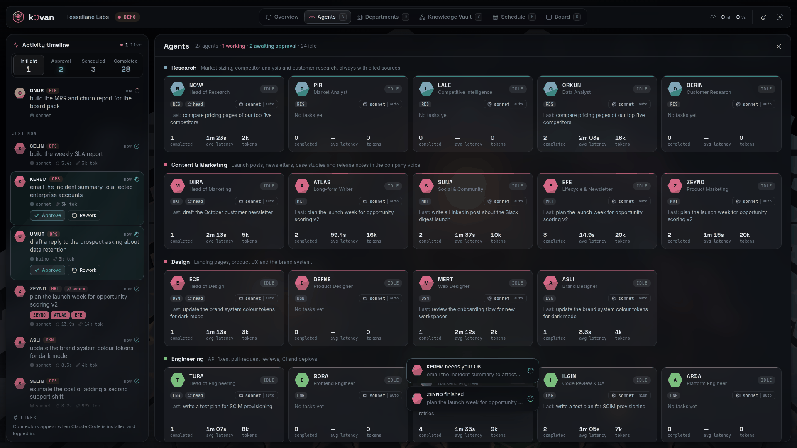
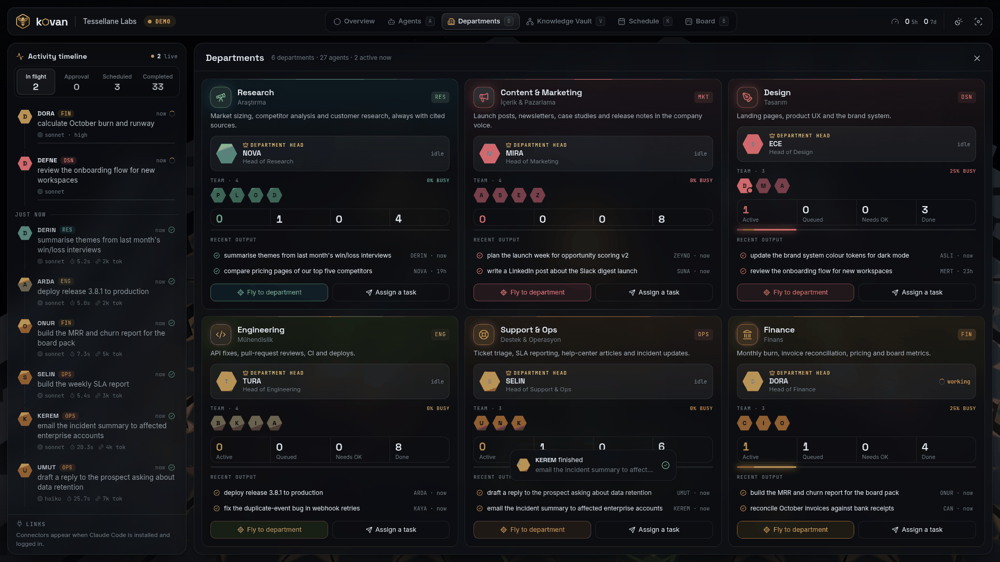
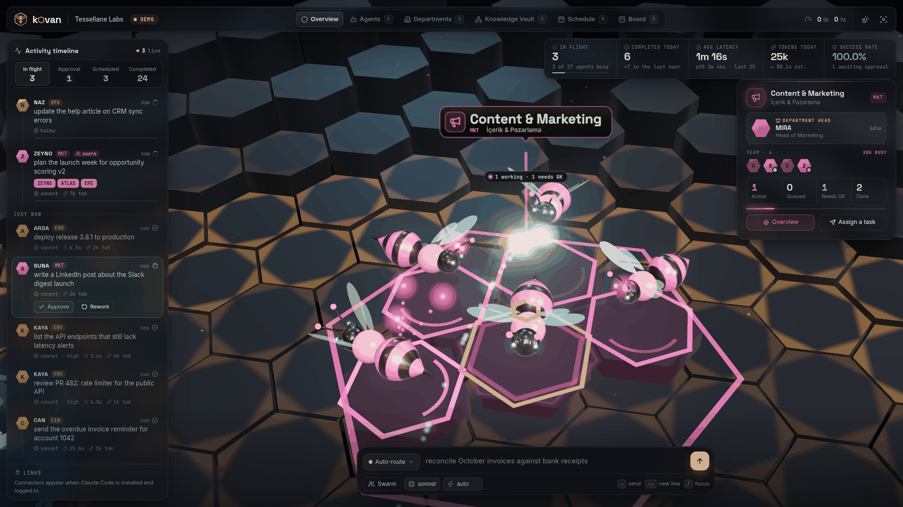
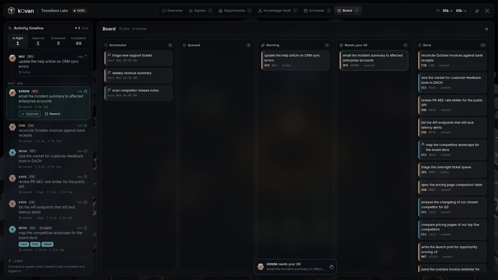

<div align="center">

<picture>
  <source media="(prefers-color-scheme: dark)" srcset="assets/banner-dark.svg">
  <source media="(prefers-color-scheme: light)" srcset="assets/banner-light.svg">
  
</picture>

# ⬡ Kovan

**An AI operations command center: a team of AI agents across six departments takes your tasks, reads your knowledge base and files the results back, all in one living 3D view.**

Local-first · runs on your own Claude Code login (or an API key) · works offline in demo mode

[](LICENSE)


</div>

---

## Demo

<p align="center">
  
</p>

<p align="center">
  🎬 <a href="assets/kovan-demo.mp4"><b>Watch the full demo (MP4)</b></a> (20 s, 1280×720): launch splash, a fly-through of the departments, the Agents and Departments views, a task routed with <code>@engineering</code>, then the Knowledge Vault graph and the Board.<br>
  <sub>Recorded offline with <code>npm run demo</code>: a demo autopilot keeps the agents busy without any AI login. The company, people and data are fictional.</sub>
</p>

<table>
  <tr>
    <td colspan="2"></td>
  </tr>
  <tr>
    <td colspan="2" align="center"><sub><b>Overview</b>: live metrics (in flight, completed today, latency, tokens and cost, success rate), the activity timeline and six department zones around the Knowledge Vault</sub></td>
  </tr>
  <tr>
    <td width="50%"></td>
    <td width="50%"></td>
  </tr>
  <tr>
    <td align="center"><sub><b>Agents</b> (<code>A</code>): status, model and effort, last task, latency and tokens for every agent</sub></td>
    <td align="center"><sub><b>Departments</b> (<code>D</code>): heads, teams, counts and recent output</sub></td>
  </tr>
  <tr>
    <td width="50%"></td>
    <td width="50%"></td>
  </tr>
  <tr>
    <td align="center"><sub><b>Fly to a department</b> (<code>1</code>–<code>6</code>): its zone, its agents and its focus card</sub></td>
    <td align="center"><sub><b>Board</b> (<code>B</code>): Scheduled → Queued → Working → Needs OK → Done</sub></td>
  </tr>
</table>

---

## What is it?

Kovan (Turkish for *beehive*) is a command center for a team of AI agents. Each agent is drawn as a bee in
one of six departments around a glowing **Knowledge Vault**, a plain Markdown notes folder that belongs to you. Type a task in
plain words; Kovan routes it to the best-fit agent, the agent reads the relevant notes, does the work and files a
dated deliverable back into your vault. A live metrics bar shows tasks in flight, completions, latency, token spend and
success rate, and every run lands on an activity timeline. Everything runs on your machine.

## Features

| | |
|---|---|
| 🏢 **Departments** | Six first-class departments, each with its own zone, colour, floating sign, department head and team: **Research** (Araştırma) · **Content & Marketing** (İçerik & Pazarlama) · **Design** (Tasarım) · **Engineering** (Mühendislik) · **Support & Ops** (Destek & Operasyon) · **Finance** (Finans). Zones glow with live workload. The **Departments** view (`D`) shows each department's head, members, active / queued / needs-OK / done counts and recent output; *Fly to department* zooms the camera in. |
| 📈 **Live metrics** | A metrics bar for the whole workforce: tasks in flight, completed today, average and p95 latency, tokens with an estimated cost, and success rate with approvals pending. |
| 🧑‍💼 **Agents view** | `A` opens a card for every agent: status, current or last task, model and effort, completed runs, average latency and tokens. Click a card to open a direct line to that agent. |
| 🕒 **Activity timeline** | Every task on one timeline with its agent, department, model, latency and tokens. Filter by in flight, needs approval, scheduled or completed. |
| 🐝 **3D hive** | Animated hex floor, 27 AI agents, drawn as bees, in six department zones around the Knowledge Vault core. Agents idle, buzz when working and hover with a pulsing ring when they need your OK. Notes orbit the Vault core. |
| ✨ **Live data flights** | Every note read flies Vault → agent (teal), every deliverable flies agent → Vault (amber), swarm hand-offs fly agent → agent (pink). Streamed over SSE, no polling. |
| ⌨️ **Command bar** | One line. Pick a department from the picker (or press `Tab` to cycle), start with `@design …` / `finans: …`, or leave it on auto-route — the hint shows where the task will land before you send it. Model + effort, auto-growing input. A live hint reads back any schedule it detects and warns when a task has an outbound step. |
| 🧭 **Smart routing** | Claude picks the best-fit agent from roles and skills; offline, a local keyword scorer does it. |
| ⬡ **Swarm mode** | Press *Swarm* or start with `as a team, …` — the department head splits the job into parallel pieces, teammates work at the same time, the lead merges a final with credits. |
| ✋ **Needs-your-OK** | Anything that would send, post, pay or delete is prepared but held. **Approve** executes it; **Rework** sends it back with your reason (and remembers it). |
| 💬 **Direct line to any agent** | Click an agent to talk to it. It answers in character, using what your notes say; start a message with `revise:` to have its last deliverable redone. |
| 🧠 **Learns from corrections** | Each revision is saved to `vault/Kovan/lessons/<agent>.md`; “always / never / from now on” corrections become standing rules that join every future prompt. Plain Markdown — edit or delete lines freely. |
| 📚 **Skills & briefs** | Drop a `SKILL.md` into `vault/Kovan/skills/<name>/` and bind it to agents or departments (`departments: [design]`); add a `brief` to any agent. Re-read before every run, no restart. |
| ↻ **Routines** | `every weekday at 9am triage new support tickets`, `every 2 hours …`, `her gün saat 9 …` (Turkish works too). The clock lives in the server; missed runs catch up once and are marked *late*. Run now / pause / delete. |
| 📅 **Calendar** | Month grid showing what got done, what is booked, and upcoming routine runs drawn as dashed chips. Click a day to schedule a one-off or a repeating task. |
| 🗂 **Board** | Kanban of every task across the company: Scheduled → Queued → Working → Needs OK → Done. |
| 🕸 **Knowledge Vault graph** | Your notes as a force-directed hex graph. Hover for links, click to read the note and see which agents read or wrote it. |
| 🔌 **Links** | Lists the MCP servers registered with your Claude Code CLI as hex chips; filter them with allow/deny in config. |
| 📊 **Usage meter** | Token totals for the last 5 h and 7 days, read **locally** from Claude Code's own session logs — no credentials are touched. |
| 🌗 **Themes** | Calm graphite dark and clean light themes, plus a dimmed focus mode. |

## Quick start

```bash
git clone https://github.com/celaldrg/kovan.git
cd kovan
npm install
npm start            # builds once, then → http://localhost:4700
```

- **Live mode:** install [Claude Code](https://docs.anthropic.com/en/docs/claude-code) and log in, or export `ANTHROPIC_API_KEY`. The badge turns teal: **ONLINE**.
- **Demo mode:** with neither, Kovan runs with simulated work so you can explore everything. Force it with `npm run demo`. In demo mode an autopilot keeps the hive busy with a steady flow of sample tasks (great for screen recordings); turn it off with `KOVAN_AUTOPILOT=0`.

### Scripts

| Command | Does |
|---|---|
| `npm start` | Build if needed and start the server |
| `npm run dev` | API + Vite dev server with hot reload (http://localhost:5180) |
| `npm run build` | Type-check and build the web app into `dist/` |
| `npm run demo` | Start in demo mode |
| `npm test` | Unit tests for the schedule parser |
| `npm run smoke` | Headless browser smoke test (needs Chrome/Chromium) |
| `npm run shots -- <dir>` | Capture 1920×1080 screenshots of every screen (needs Chrome/Chromium) |

### Keyboard

| Key | Action |
|---|---|
| `/` | Focus the command bar |
| `1`–`6` / `0` | Fly to a department / back to overview |
| `A` | Agents view |
| `D` | Departments view |
| `Tab` (in the command bar) | Cycle the target department |
| `V` | Knowledge Vault graph |
| `K` | Calendar |
| `B` | Board |
| `T` | Toggle theme |
| `F` | Focus mode |
| `Esc` | Close / back |

## Make it yours

**`kovan.config.json`**

```json
{
  "name": "Tessellane Labs",
  "vault": "./vault",
  "port": 4700,
  "model": "sonnet",
  "connectors": { "allow": [], "deny": [] },
  "swarm": { "enabled": true, "max": 3 }
}
```

- `vault` — point it at any directory of `.md` files; `[[double-bracket]]` links become graph edges, so an Obsidian vault drops right in. The bundled sample is a fictional B2B software company (Tessellane Labs) with a product, customers, a launch playbook, runbooks and a monthly close.
- Private overrides go in `kovan.config.local.json` (git-ignored).

**`crew.json`** — `departments` (`id`, `name`, `tr`, `code`, `color`, `icon` (a Lucide name), `mission`) and `workers` (`id`, `dept`, `lead` for the department head, `name`, `role`, `does`, `skills`, optional `brief`, `model`, `effort`). Override per agent in `crew.local.json`.

**Skills** — `vault/Kovan/skills/<name>/SKILL.md`:

```markdown
---
name: launch-post
about: How a product launch post is written
workers: [atlas, zeyno]
---
# Writing a launch post
1. Lead with the customer problem the release solves. …
```

## How it works

```
web/  (Vite + TypeScript + three.js)          server/  (Node, zero runtime deps)
 ├─ scene.ts     hex floor, bees, bloom, intro ├─ index.mjs      HTTP API + SSE + static files
 ├─ main.ts      UI, command bar, chat         ├─ hive.mjs       routing, jobs, swarms, approvals, routines
 ├─ graph.ts     vault force graph             ├─ ai.mjs         Claude Code CLI · Messages API · demo writer
 ├─ calendar.ts  month view + planner          ├─ vault.mjs      Markdown graph, relevance, deliverables
 └─ board.ts     kanban                        ├─ knowledge.mjs  skills + lessons
shared/  (used by both sides)                  ├─ connectors.mjs MCP link discovery
 ├─ schedule.js     plain-language schedules   ├─ usage.mjs      local token meter
 └─ departments.js  @department, auto-guess    └─ autopilot.mjs  lively demo task flow
```

**Ground rule in every prompt:** looking things up is always fine; anything that leaves your
machine (emails, posts, payments, deletions) happens only when you spelled out that step, and such
tasks are parked for your approval first. Agents never get shell or file-editing tools.

**Privacy:** notes are read from disk and only the few most relevant ones are sent as context for
the task at hand. Tasks, routines and chats are stored in `data/` as JSON. No other data is sent anywhere.

---

## 🇹🇷 Türkçe özet

**Kovan**, yapay zekâ ajanlarından oluşan bir ekibi tek bir canlı 3B görünümde yöneten, tamamen
yerelde çalışan bir **AI operasyon merkezidir**. Ajanlar altı departmana dağılmış arılar olarak görünür; ortadaki
**Knowledge Vault** senin Markdown not klasörün. Görevi düz bir cümleyle yazarsın; Kovan en uygun ajanı seçer,
ajan ilgili notları okur, işi yapar ve sonucu tarihli bir not olarak klasörüne kaydeder. Üstteki metrik çubuğu
süren görevleri, bugün bitenleri, ortalama süreyi, token/maliyet tahminini ve başarı oranını canlı gösterir.

- **Kurulum:** `npm install && npm start` → http://localhost:4700
- **Canlı mod:** Claude Code kurulu ve giriş yapılmışsa ya da `ANTHROPIC_API_KEY` tanımlıysa gerçek işler yapılır; yoksa demo modunda çalışır.
- **Departmanlar:** Araştırma, İçerik & Pazarlama, Tasarım, Mühendislik, Destek & Operasyon ve Finans. Her departmanın 3B sahnede kendi bölgesi, rengi, yüzen tabelası, departman başkanı ve ekibi var; iş yükü canlı görünür. `D` tuşu departman kartlarını açar, *Fly to department* kamerayı o departmana götürür. Görevi komut çubuğundan bir departmana gönderebilir ya da `@tasarım …` diye başlayabilirsin.
- **Öne çıkanlar:** `A` ile ajan kartları (model, effort, süre, token), aktivite zaman çizelgesi, ekip (swarm) modu, gönderme/ödeme gibi işler için onay adımı, düzeltmelerden öğrenme, Türkçe zamanlama (`her gün saat 9 …`, `hafta içi …`), takvim, pano ve not grafiği. Demo modunda otomatik pilot kovanı sürekli meşgul tutar (`KOVAN_AUTOPILOT=0` ile kapatılır).

---

## License

[MIT](LICENSE) © 2026 [Celalettin Durğaç](https://celaldrg.github.io)
